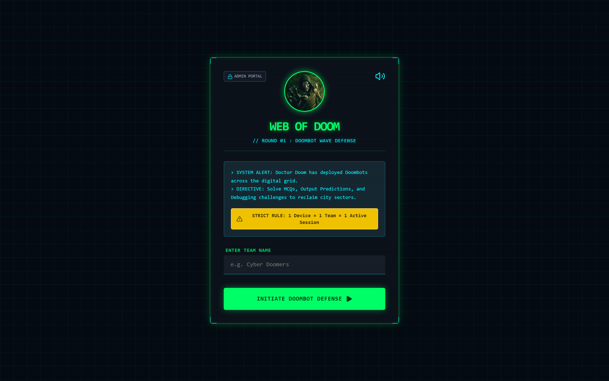
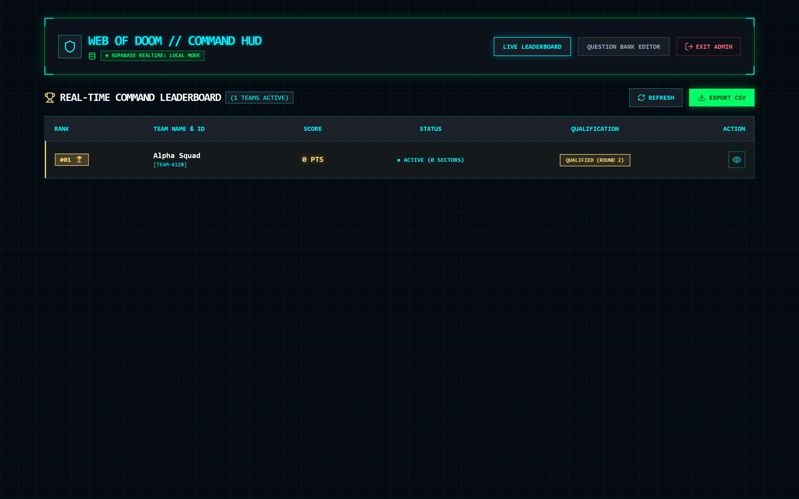
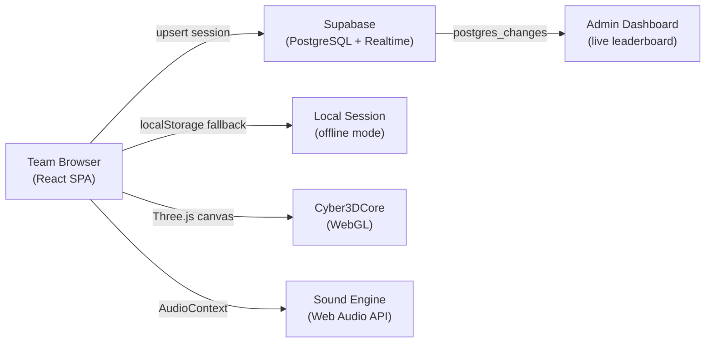

<div align="center">

# ⚔️ WEB OF DOOM

**Round 01: Doombot Wave Defense**

*A cyberpunk-themed competitive programming quiz platform built for live tech events*

[](https://technovation-web-of-doom.vercel.app)
[](https://react.dev)
[](https://www.typescriptlang.org)
[](https://supabase.com)
[](https://vite.dev)

</div>

---

## Overview

**Web of Doom** is the competitive round platform built for the **Technovation** coding event. Teams race against a 30-minute countdown to clear as many programming challenges as possible, earning points by defeating **Doombots** — in-universe enemies that represent each unsolved question.

The platform was designed to run live during the event with a projected admin leaderboard, automatic score syncing via Supabase Realtime, and a built-in anti-cheat system that penalizes tab switching and browser refresh attempts.

> [!IMPORTANT]
> **1 Device · 1 Team · 1 Active Session** — a device-token lock prevents the same team from opening a session on multiple machines simultaneously.

---

## Screenshots

| Login Screen | Gameplay |
|:---:|:---:|
|  |  |

| Question Card | Admin Command HUD |
|:---:|:---:|
|  |  |

---

## Concept & Event Flow

```
Team arrives at station
        │
        ▼
  Team Login Modal ──► Enter team name ──► Auto-generated Team ID
        │                                      │
        ▼                                      ▼
  Session created in Supabase ◄──────── Device token assigned
        │
        ▼
  30-minute countdown begins
        │
        ├── Solve MCQ / Output / Debugging questions
        ├── Each correct answer fires a Laser Blast at the 3D Doombot Core
        ├── Score syncs to Supabase in real time
        └── Admin leaderboard updates live on projector
        │
        ▼
  Time up or all questions solved ──► Mission Complete screen
        │
        ▼
  Admin announces Top 4 teams advancing to Round 02
```

Each question answer is **final** — once submitted, it cannot be changed. Hints can be revealed at any time but are tracked and visible to admins.

---

## Features

### 🎮 Gameplay
- **Three question types** — Multiple Choice (MCQ), Output Prediction, and Code Debugging
- **Eight DSA topics** — Arrays, Strings, Stacks/Queues, Recursion, Time Complexity, Basic Trees, Trees & Graphs, DP & Greedy
- **Tiered scoring** — Easy +100 pts · Medium +200 pts · Hard +300 pts
- **30-minute session timer** synchronized from server-side `start_time`; audio alarms fire at 5 min, 1 min, and 10 sec remaining
- **Hint system** — each hint reveal is logged per-question and reflected in the final summary

### 🎯 3D Tactical HUD (`Cyber3DCore`)
Built entirely with **Three.js** — no WebGL library abstraction:
- Rotating geodesic icosahedron wireframe shield (outer boss layer)
- Spinning torus-knot cyber core with emissive green glow
- Two orbiting holographic rings (cyan + magenta)
- 250-particle starfield with slow drift
- **Mouse parallax** — camera tracks cursor position smoothly
- **Shockwave pulse** — triggered on each correct answer; scales the shield, shifts color, and spikes the point light intensity

### 🔊 Web Audio Sound Engine (`soundEngine.ts`)
Procedurally generated using the **Web Audio API** — no audio files required:

| Sound | Trigger |
|---|---|
| Futuristic click | Button interactions |
| Laser blast (sawtooth sweep) | Correct answer |
| 4-note fanfare (C5–C6) | Session start, correct submit |
| Square-wave alarm | Timer warnings (5 min, 1 min, 10 sec) |
| 4-second siren sweep | Tab-switch / refresh violation |

### 🛡️ Anti-Cheat System
| Violation | Consequence |
|---|---|
| Tab switch / browser blur (1–4×) | Shuffle question order + warning modal + 4-sec siren |
| Browser refresh (detected via `PerformanceNavigationTiming`) | Counts as a tab switch violation |
| Keyboard shortcut refresh (F5 / Ctrl+R / Cmd+R) | Intercepted; counts as a violation |
| Tab switch / refresh (5th time) | **Auto-submit + permanent session lockout** |

The **Security Lockout Screen** is an irrecoverable state — teams can view their locked score but cannot interact with questions.

### 📊 Admin Command HUD
Protected by a configurable PIN (`VITE_ADMIN_PIN`, default `2026`).

- **Live Leaderboard** — scores, completion status, hints used, disqualification status; sorts by score then by start time (tiebreak)
- **Supabase Realtime subscription** — leaderboard refreshes automatically on any session change
- **CSV export** — one-click download of all session data for post-event record-keeping
- **Question Bank Editor** — inline editor to add, modify, or reorder questions without redeploying; custom sets are persisted in `localStorage`
- Anti-cheat is **disabled** while in admin mode so organizers can freely navigate

---

## Architecture



**Data flow:**  
1. `initializeTeamSession` checks Supabase for an existing session by `team_id`; resumes it on the same device or blocks a foreign device (within 30 min window).  
2. Every answer submit calls `syncSessionState`, which calls `localStorage` first (always succeeds), then fires an async `upsert` to Supabase.  
3. If Supabase is not configured, the app runs fully in **local/offline mode** — all data lives in `localStorage`.

---

## Tech Stack

| Layer | Technology |
|---|---|
| Framework | React 19 + TypeScript 6 |
| Build tool | Vite 8 + Rolldown |
| Styling | Tailwind CSS v4 |
| 3D graphics | Three.js r185 |
| Backend / DB | Supabase (PostgreSQL + Realtime) |
| Audio | Web Audio API (zero external files) |
| Confetti | canvas-confetti |
| Icons | Lucide React |
| Linting | oxlint |
| Deployment | Vercel (SPA rewrite rule) |

---

## Project Structure

```
src/
├── components/
│   ├── admin/
│   │   ├── AdminDashboard.tsx      # PIN-gated admin shell with tab switching
│   │   ├── LiveLeaderboard.tsx     # Realtime leaderboard + CSV export
│   │   └── QuestionEditor.tsx      # Inline question bank editor
│   ├── AudioToggle.tsx             # Mute/unmute control
│   ├── Cyber3DCore.tsx             # Three.js 3D animated boss HUD
│   ├── DoombotBattleCanvas.tsx     # Wrapper panel for Cyber3DCore
│   ├── HeaderHUD.tsx               # Sticky header: timer, score, shield, team
│   ├── HintModal.tsx               # Hint reveal confirmation dialog
│   ├── MissionCompleteScreen.tsx   # End screen with confetti + score summary
│   ├── QuestionCard.tsx            # Question display + option selection + submit
│   ├── QuestionNavigator.tsx       # Grid-based question index with status colors
│   ├── SecurityLockoutScreen.tsx   # Irrecoverable anti-cheat lockout screen
│   ├── TabViolationModal.tsx       # Violation warning overlay
│   └── TeamLoginModal.tsx          # Splash / team registration screen
├── data/
│   └── defaultQuestions.ts         # 15+ built-in DSA questions (3 per topic)
├── lib/
│   └── supabase.ts                 # Supabase client init + config check
├── styles/
│   └── hud.css                     # Global CRT scanlines, glassmorphism, neon glows
├── types/
│   └── game.ts                     # TypeScript interfaces: Question, TeamSession, etc.
└── utils/
    ├── soundEngine.ts              # Web Audio API procedural sound class
    ├── storage.ts                  # localStorage helpers (session, questions, admin state)
    └── syncService.ts              # Supabase CRUD: init session, sync state, fetch admin data
```

---

## Setup

### Prerequisites
- Node.js 20+ and npm

### Local development

```bash
git clone https://github.com/samuelmichaelalva/Technovation_Web_of_Doom.git
cd Technovation_Web_of_Doom
npm install
cp .env.example .env
# Edit .env with your Supabase credentials (optional — app works offline without them)
npm run dev
```

The app runs at `http://localhost:5173`. Without a `.env`, it falls back to full localStorage mode.

### Supabase setup (optional, for live leaderboard)

1. Create a project at [supabase.com](https://supabase.com).
2. Run [`schema.sql`](./schema.sql) in the **SQL Editor** to create the `teams`, `sessions`, and `questions` tables and enable Realtime.
3. Copy your **Project URL** and **anon key** to `.env`:

```env
VITE_SUPABASE_URL=https://your-project.supabase.co
VITE_SUPABASE_ANON_KEY=your-anon-key
VITE_ADMIN_PIN=your-custom-pin
```

### Vercel deployment

```bash
npm run build
# Deploy the dist/ folder, or push to GitHub and connect to Vercel
```

Vercel rewrites all routes to `/index.html` via [`vercel.json`](./vercel.json).

---

## Team

**Samuel Michael Alva** — built the full-stack application from initial scaffold through event day. This covered the React component architecture, the Three.js 3D Doombot HUD with shockwave feedback, the procedural Web Audio sound engine, the Supabase sync layer with offline fallback, the anti-cheat detection system (tab switch, keyboard intercept, reload detection), the admin dashboard with realtime leaderboard and CSV export, and iterative debugging and UI polish across all screens.

---

## Acknowledgements

Built for the **Technovation** event, Round 01: *Doombot Wave Defense*.  
Deployed on [Vercel](https://vercel.com). Backend by [Supabase](https://supabase.com).

---

<div align="center">
<sub>WEB OF DOOM // ROUND 01 // DOOMBOT DEFENSE // VERCEL READY</sub>
</div>
