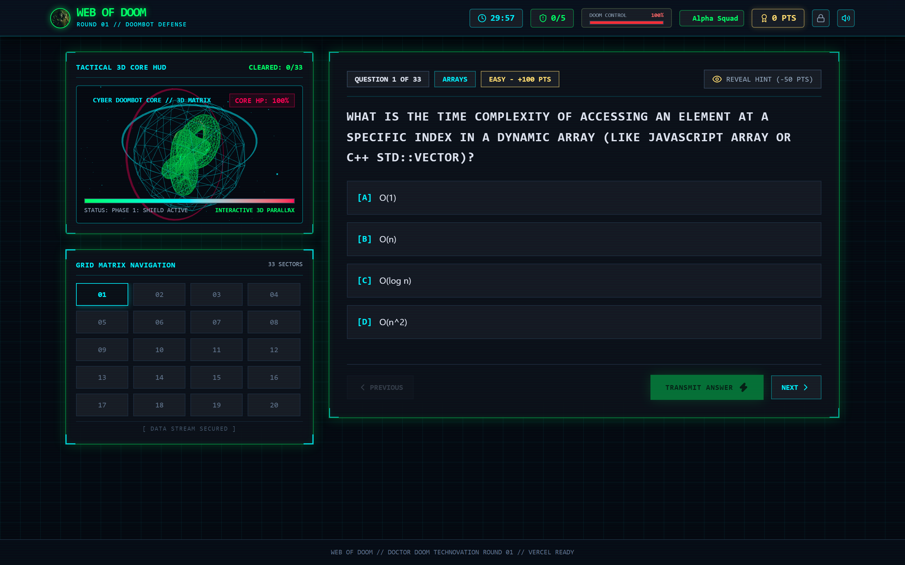
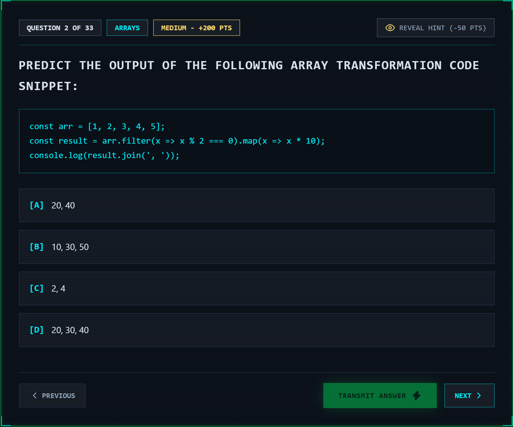
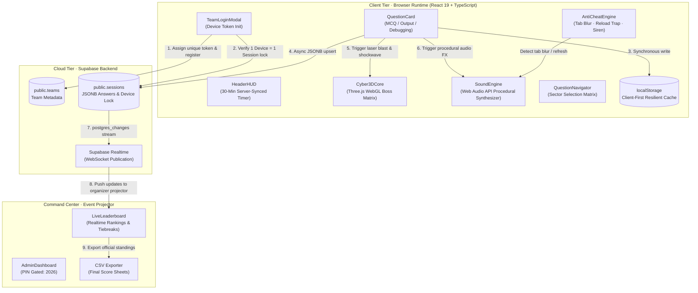

# Web of Doom
### *Round 01: Doombot Wave Defense — Competitive Engineering Arena*

[](https://technovation-web-of-doom.vercel.app)
[](https://technovation-web-of-doom.vercel.app)
[](https://react.dev)
[](https://www.typescriptlang.org)
[](https://threejs.org)
[](https://supabase.com)
[](https://tailwindcss.com)

---

## ⚡ 60-Second Summary

> **Web of Doom** is a real-time, cyberpunk-themed competitive programming platform custom-engineered for **Technovation** (Round 01: *Doombot Wave Defense*).
> Competing student teams race against a synchronized 30-minute countdown to dismantle Doctor Doom's cyber grid by solving algorithmic challenges spanning 8 Data Structures & Algorithms domains (Multiple Choice, Output Prediction, and Code Debugging).
> The platform features an interactive **Three.js WebGL 3D tactical boss core**, a zero-dependency **procedural Web Audio sound synthesis engine**, strict **5-strike client-side anti-cheat protection** (monitoring tab switches, window blurs, and navigation reloads), and **Supabase Realtime** synchronization with an administrative command center and live leaderboard projector.

---

## 🔗 Project Resources & Links

| Resource | Link | Description |
| :--- | :--- | :--- |
| 🌐 **Live Web Application** | [technovation-web-of-doom.vercel.app](https://technovation-web-of-doom.vercel.app) | Production deployment hosted on Vercel |
| 🐙 **Source Code Repository** | [github.com/samuelmichaelalva/Technovation_Web_of_Doom](https://github.com/samuelmichaelalva/Technovation_Web_of_Doom) | Public GitHub source repository |
| 🗄️ **Database Schema** | [`schema.sql`](./schema.sql) | Supabase PostgreSQL schema with RLS & Realtime triggers |
| 🔐 **Deployment Config** | [`vercel.json`](./vercel.json) | Production SPA route rewrite configuration |

---

## 📑 Project Details

| Parameter | Specification |
| :--- | :--- |
| **Event** | Technovation (Technical Symposium) |
| **Round / Track** | Round 01: Doombot Wave Defense |
| **Role** | Technical Event Coordinator & Lead Developer |
| **Architecture** | Client-First React SPA · Supabase Realtime · WebGL 3D Engine · Web Audio API |
| **Live Deployment** | [technovation-web-of-doom.vercel.app](https://technovation-web-of-doom.vercel.app) |
| **Target Audience** | Collegiate Engineering & Computer Science Participants |
| **Status** | Production Event Platform (Fully Functional) |

---

## Table of Contents

* [01. Project Overview & Background](#01-project-overview--background)
* [02. Problem Statement & Arena Concept](#02-problem-statement--arena-concept)
* [03. Key Features & Gameplay Mechanics](#03-key-features--gameplay-mechanics)
* [04. Screenshots & Live Experience](#04-screenshots--live-experience)
* [05. System Architecture & Data Flow](#05-system-architecture--data-flow)
* [06. Audio Synthesis & 3D Visual Feedback](#06-audio-synthesis--3d-visual-feedback)
* [07. Anti-Cheat & Security Protocol](#07-anti-cheat--security-protocol)
* [08. Technology Stack](#08-technology-stack)
* [09. Project Structure](#09-project-structure)
* [10. Installation & Setup](#10-installation--setup)
* [11. Environment Configuration & Database Schema](#11-environment-configuration--database-schema)
* [12. Role & Event Contributions](#12-role--event-contributions)

---

## 01. Project Overview & Background

During technical festivals and competitive hackathons, conventional quiz or coding rounds are frequently hosted on generic assessment forms or static evaluation websites. These off-the-shelf tools lack atmosphere, offer minimal live feedback for competing teams, and provide no visual spectacle for spectators in the venue.

**Web of Doom** was conceived, designed, and deployed specifically to solve this for **Technovation**, transforming a competitive technical screening round into an engaging, gamified arena experience.

### The Lore & Event Mechanics
* Teams take on the role of digital defense operatives tasked with dismantling **Doctor Doom's cybernetic Doombot network**.
* Each coding question represents an active sector node controlled by a Doombot.
* Correct answers trigger live **laser blast shockwaves** against an interactive 3D WebGL core, diminishing Doctor Doom's control percentage in real time.
* Every team's scores and submission timestamps are streamed live to the event hall projector via Supabase Realtime, enabling coordinators to monitor standings and advance the Top 4 qualifying squads to Round 02 (*Reclaim the City*).

---

## 02. Problem Statement & Arena Concept

### The Challenges

1. **Station Integrity & Identity Hijacking**: In open lab environments, teams frequently attempt to open multiple browser tabs or log in from secondary mobile devices to divide questions among teammates.
2. **Cheat Mitigation Without Kernel Extensions**: Standard web apps allow participants to look up answers on external search engines, switch tabs, or refresh the browser to reset penalty states.
3. **Network Resiliency During Live Events**: Campus Wi-Fi can drop unexpectedly during intense competition sessions. An event platform cannot crash or lose candidate answers due to intermittent packet loss.
4. **Spectator & Participant Engagement**: Traditional technical rounds offer dry forms. Creating a tense, high-stakes atmosphere requires audio-visual cues, countdown sirens, and real-time visual rewards.

### The Solutions

| Challenge | Web of Doom's Approach |
| :--- | :--- |
| **Multi-device tampering** | Hardware-linked **device-token session lock**: 1 Team = 1 Active Device. Secondary devices are immediately rejected. |
| **Tab switching & search** | **5-Strike Anti-Cheat Engine**: Page blur triggers an oscillating 4-second emergency siren, shuffles question order, and logs violations. 5th strike causes **permanent disqualification**. |
| **Refresh workarounds** | Reload attempts are trapped via `PerformanceNavigationTiming` on mount and keydown listeners (`F5`, `Ctrl+R`, `Cmd+R`), treating reloads as cheat violations. |
| **Network interruptions** | **Local-First sync architecture**: Every submission writes synchronously to `localStorage` before attempting an async upsert to Supabase. Full offline fallback supported. |
| **Live venue atmosphere** | Monospace CRT scanlines, neon HUD typography, Three.js 3D boss core parallax, and procedural Web Audio synthesizers (no external MP3 downloads). |

---

## 03. Key Features & Gameplay Mechanics

### 🎮 Algorithmic Question Bank
* **Three Interaction Modalities**:
  * **MCQs**: Conceptual algorithmic evaluation and complexity classification.
  * **Output Prediction**: Interpreting intricate JavaScript/C++ data mutations and higher-order array filters.
  * **Code Debugging**: Detecting off-by-one boundary bugs, array reversal inversions, and pointer mishandling.
* **Eight DSA Knowledge Tracks**: Arrays, Strings, Stacks/Queues, Recursion, Time Complexity, Basic Trees, Trees & Graphs, and Dynamic Programming/Greedy.
* **Tiered Scoring**:
  * `Easy`: +100 PTS
  * `Medium`: +200 PTS
  * `Hard`: +300 PTS

### ⏱️ Session Synchronization & Hint Mechanics
* **30-Minute Global Countdown**: Calculated from server-anchored `startTime` timestamps, preventing local system clock tampering.
* **Auditory Threshold Alerts**: Alarms trigger automatically at 5 minutes (300s), 1 minute (60s), and final countdown (10s).
* **Strategic Hint System**: Teams can reveal encrypted hints per question. Hint usage is tracked and factored into tie-breaking analytics on the admin leaderboard.

### 🛡️ Administrative Command Portal
* **Master PIN Authentication**: Gated by configurable security PIN (`VITE_ADMIN_PIN`, default: `2026`).
* **Live Leaderboard with Real-Time Subscriptions**: Instant score updates streamed over PostgreSQL `postgres_changes` websocket publication.
* **One-Click CSV Export**: Organizers can instantly download formatted spreadsheets containing ranks, team IDs, raw scores, hints taken, and completion timestamps.
* **Dynamic Question Bank Editor**: Real-time interface for organizers to edit question prompts, adjust points, and insert custom problem statements on the fly.

---

## 04. Screenshots & Live Experience

**Production Deployment:** [technovation-web-of-doom.vercel.app](https://technovation-web-of-doom.vercel.app)

### Core Interface

| Team Authentication Portal | Tactical Battle HUD & 3D Core |
| :---: | :---: |
|  |  |
| *Doctor Doom security briefing, audio synthesizer toggle, and team registration* | *Interactive Three.js 3D boss matrix, real-time timer HUD, and question navigator* |

| Question Card & Code Inspection | Command HUD & Live Leaderboard |
| :---: | :---: |
|  |  |
| *Syntax-highlighted code block, difficulty badge, points weighting, and hint modal* | *Realtime session telemetry, tie-breaker rankings, and CSV export functionality* |

---

## 05. System Architecture & Data Flow

Web of Doom is built on a resilient, client-first architecture where the React application guarantees zero data loss through local storage while broadcasting updates to Supabase PostgreSQL over WebSockets.



### Session Lifecycle & 1-Device Lock

1. **Authentication**: Entering a team name generates a cryptographically random team ID and creates a unique `device_token` stored in `localStorage`.
2. **Device Lock Verification**: When connecting to Supabase, the backend checks whether an active session already exists for that team. If a session is active on a different device within the 30-minute window, the foreign connection is rejected with `ACCESS DENIED`.
3. **Progress Synchronization**: Every answer submission updates local state immediately, then commits a JSONB payload to Supabase containing all answered question IDs, chosen options, timestamps, and hints revealed.

---

## 06. Audio Synthesis & 3D Visual Feedback

### Procedural Web Audio Engine (`soundEngine.ts`)
Rather than relying on large external audio files that could fail to load over congested event networks, all audio effects are **synthesized mathematically at runtime** using the native browser `AudioContext`:

| Sound Effect | Waveform | Frequency Modulation | Event Trigger |
| :--- | :---: | :--- | :--- |
| **Tactical Click** | Sine | $800\,\text{Hz} \to 300\,\text{Hz}$ exponential ramp ($50\,\text{ms}$) | Button & option selections |
| **Laser Blast** | Sawtooth | $1200\,\text{Hz} \to 100\,\text{Hz}$ decay ($300\,\text{ms}$) | Correct answer submit |
| **Fanfare** | Triangle | 4-note melodic arpeggio ($C_5, E_5, G_5, C_6$) | Session start & mission success |
| **Warning Alarm** | Square | Bimodal toggle ($880\,\text{Hz} \leftrightarrow 440\,\text{Hz}$) | 5 min, 1 min, and 10 sec remaining |
| **Security Siren** | Sawtooth | 16-step continuous sweep ($600\,\text{Hz} \leftrightarrow 1400\,\text{Hz}$) for $4.0\,\text{s}$ | Tab switch / reload violation |

### Three.js 3D Tactical Core (`Cyber3DCore.tsx`)
Rendered directly via WebGL with custom lighting and mesh hierarchies:
* **Outer Boss Shield**: Rotating `IcosahedronGeometry(1.8, 2)` wireframe with cyan emissive styling.
* **Inner Core**: Highly reflective `TorusKnotGeometry(0.8, 0.25, 100, 16)` wireframe pulsing in radioactive neon green.
* **Holographic Rings**: Dual counter-rotating `RingGeometry` meshes orbiting along independent Euler axes.
* **Parallax Camera Physics**: Mouse position interpolates camera target angles smoothly using spring dampers.
* **Shockwave Blast Reaction**: Correct answers trigger an animated shockwave that scales the geometry by $1.4\times$, flashes the material to pure neon green, and surges point-light intensity from $3$ to $13$.

---

## 07. Anti-Cheat & Security Protocol

To ensure competitive fairness without requiring intrusive software installations, Web of Doom implements a multi-layered client-side security architecture:

```
Violation Detected (Tab Blur, Focus Loss, Window Minimization, or Reload)
                     │
                     ▼
       Trigger 4-Second Security Siren SFX
                     │
       ┌─────────────┴─────────────┐
       ▼                           ▼
Violations 1 to 4              Violation 5 (Limit Reached)
  • Increment violation counter   • Auto-submit all answers
  • Randomize question order      • Write is_disqualified = true to Supabase
  • Display warning modal dialog  • Lockout to SecurityLockoutScreen
                                  • Permanent session termination
```

### Security Enforcement Matrix

| Vector | Detection Technique | Enforcement Action |
| :--- | :--- | :--- |
| **Tab Switching** | `document.visibilityState === 'hidden'` & `window.onblur` | Triggers violation warning; shuffles unanswered questions. |
| **Browser Reload** | `performance.getEntriesByType('navigation')[0].type === 'reload'` | Evaluated on mount; penalized immediately as a violation. |
| **Keyboard Shortcuts** | Keydown traps on `F5`, `Ctrl+R`, `Ctrl+Shift+R`, `Cmd+R` | Intercepted via `e.preventDefault()`; triggers security modal. |
| **Multi-Tab Partitioning** | Local token comparisons against active Supabase session | Prevents team members from distributing questions across machines. |
| **5th Violation** | Strict threshold check (`newCount >= 5`) | Triggers permanent **Security Lockout Screen**; score frozen. |

---

## 08. Technology Stack

### Frontend Architecture
| Component | Technology | Detail |
| :--- | :--- | :--- |
| **Framework** | React 19.2 | Component-driven UI, custom hooks, reactive state |
| **Language** | TypeScript 6.0 | Strict type safety across game states, sessions, and telemetry |
| **Build Tool** | Vite 8.2 + Rolldown | High-speed compilation, lightning HMR, optimized production chunks |
| **3D Graphics** | Three.js r185 | WebGL scene graph, custom wireframes, shockwave triggers |
| **Audio** | Web Audio API | Zero-dependency procedural oscillator and gain synthesis |
| **Styling** | Tailwind CSS v4.3 | High-performance CSS engine, custom grid and glassmorphism filters |
| **Icons & VFX** | Lucide React + Canvas Confetti | Cyberpunk tactical icon set and end-game particle physics |
| **Linter** | Oxlint 1.75 | High-speed Rust-based linting for code quality |

### Backend & Cloud Services
| Component | Technology | Detail |
| :--- | :--- | :--- |
| **Database** | Supabase (PostgreSQL 15) | Relational persistence for teams, sessions, and question banks |
| **Realtime Pub/Sub** | Supabase Realtime | WebSocket streaming of session changes for live leaderboards |
| **Security** | Row Level Security (RLS) | Public event policies with strict device-token isolation |
| **Hosting** | Vercel | Global edge CDN with automated SPA rewrite rules |

---

## 09. Project Structure

```
Technovation_Web_of_Doom/
├── index.html                    # Application entry HTML with Space Grotesk typography
├── package.json                  # Dependencies & build scripts (React 19, Three.js, Vite 8)
├── tsconfig.json                 # TypeScript compiler configuration
├── vite.config.ts                # Vite 8 configuration with Tailwind CSS plugin
├── vercel.json                   # SPA routing rewrites for Vercel deployment
├── schema.sql                    # Supabase PostgreSQL schema with RLS and Realtime publications
│
├── docs/
│   └── screenshots/              # High-resolution genuine interface captures
│       ├── login.png             # Team registration & authentication portal
│       ├── gameplay.png          # Active tactical battle HUD & 3D boss core
│       ├── question_card.png     # Question interface with code debugging snippet
│       └── admin.png             # PIN-gated Command HUD & live leaderboard
│
└── src/
    ├── main.tsx                  # React DOM root bootstrapping
    ├── App.tsx                   # Master state coordinator, anti-cheat engine, timer loop
    ├── App.css                   # Global layout styling
    ├── index.css                 # Base stylesheet
    │
    ├── components/               # UI Component Hierarchy
    │   ├── AudioToggle.tsx       # Audio mute/unmute floating toggle
    │   ├── Cyber3DCore.tsx       # Three.js 3D interactive WebGL boss matrix
    │   ├── DoombotBattleCanvas.tsx# Tactical radar bracket enclosure for 3D core
    │   ├── HeaderHUD.tsx         # Sticky HUD: Countdown timer, shield meter, score badge
    │   ├── HintModal.tsx         # Tactical hint confirmation dialog
    │   ├── MissionCompleteScreen.tsx # End-game victory screen with confetti & final statistics
    │   ├── QuestionCard.tsx      # Problem card, code blocks, and submission handler
    │   ├── QuestionNavigator.tsx # Grid-based quick navigation matrix with status colors
    │   ├── SecurityLockoutScreen.tsx # Irrecoverable anti-cheat disqualification screen
    │   ├── TabViolationModal.tsx # Mid-game warning dialog for detected tab switches
    │   ├── TeamLoginModal.tsx    # Cyberpunk launch splash & team registration modal
    │   └── admin/
    │       ├── AdminDashboard.tsx # PIN-gated organizer dashboard shell
    │       ├── LiveLeaderboard.tsx# Realtime rankings, tie-breaker sorting, CSV export
    │       └── QuestionEditor.tsx # In-memory & local question bank customization editor
    │
    ├── data/
    │   └── defaultQuestions.ts   # 15+ built-in algorithmic questions across 8 DSA topics
    ├── lib/
    │   └── supabase.ts           # Supabase client instantiation & connectivity verification
    ├── styles/
    │   └── hud.css               # CRT scanlines, cyber grid, neon glows, corner brackets
    ├── types/
    │   └── game.ts               # Core TypeScript definitions (Question, TeamSession, Answers)
    └── utils/
        ├── soundEngine.ts        # Procedural Web Audio API sound synthesis engine
        ├── storage.ts            # LocalStorage persistence helpers (sessions, custom questions)
        └── syncService.ts        # Supabase CRUD operations, device locks, realtime listeners
```

---

## 10. Installation & Setup

### Prerequisites
* **Node.js**: `v20.0.0` or higher
* **npm**: `v10.0.0` or higher

---

### Step 1: Clone the Repository
```bash
git clone https://github.com/samuelmichaelalva/Technovation_Web_of_Doom.git
cd Technovation_Web_of_Doom
```

---

### Step 2: Install Dependencies
```bash
npm install
```

---

### Step 3: Configure Environment Variables
Copy the example environment configuration:
```bash
cp .env.example .env
```

Edit `.env` to supply your Supabase credentials (optional for offline testing):
```env
VITE_SUPABASE_URL=https://your-project.supabase.co
VITE_SUPABASE_ANON_KEY=your-anon-key
VITE_ADMIN_PIN=2026
```

> **Note on Offline Mode:** If Supabase environment variables are omitted, Web of Doom automatically defaults to **Local-First Mode**, storing all teams, sessions, and scores in browser `localStorage`.

---

### Step 4: Run the Development Server
```bash
npm run dev
```
Open your browser at `http://localhost:5173` to experience the arena.

---

### Step 5: Build for Production
```bash
npm run build
```
Generates production-optimized static assets in the `dist/` directory.

---

## 11. Environment Configuration & Database Schema

### Environment Variables

| Variable | Required | Default | Purpose |
| :--- | :---: | :---: | :--- |
| `VITE_SUPABASE_URL` | No | `null` | Supabase project REST & Realtime endpoint |
| `VITE_SUPABASE_ANON_KEY` | No | `null` | Supabase public anonymous API key |
| `VITE_ADMIN_PIN` | No | `2026` | Master access PIN for the Command HUD and Leaderboard |

---

### Supabase Database Initialization
To enable cloud persistence and the live projector leaderboard, run [`schema.sql`](./schema.sql) in your Supabase SQL Editor:

```sql
-- 1. TEAMS TABLE
CREATE TABLE IF NOT EXISTS public.teams (
  id UUID DEFAULT gen_random_uuid() PRIMARY KEY,
  team_id TEXT UNIQUE NOT NULL,
  team_name TEXT NOT NULL,
  created_at TIMESTAMP WITH TIME ZONE DEFAULT NOW()
);

-- 2. SESSIONS TABLE (1 Device = 1 Active Session Lock & JSONB answers)
CREATE TABLE IF NOT EXISTS public.sessions (
  id UUID DEFAULT gen_random_uuid() PRIMARY KEY,
  team_id TEXT UNIQUE REFERENCES public.teams(team_id) ON DELETE CASCADE,
  device_token TEXT NOT NULL,
  start_time TIMESTAMP WITH TIME ZONE DEFAULT NOW(),
  end_time TIMESTAMP WITH TIME ZONE,
  score INT DEFAULT 0,
  current_question_idx INT DEFAULT 0,
  answers JSONB DEFAULT '{}'::jsonb,
  hints_used JSONB DEFAULT '[]'::jsonb,
  is_completed BOOLEAN DEFAULT FALSE,
  last_active_at TIMESTAMP WITH TIME ZONE DEFAULT NOW()
);

-- Enable Realtime publication for Live Leaderboard streaming
ALTER PUBLICATION supabase_realtime ADD TABLE public.teams;
ALTER PUBLICATION supabase_realtime ADD TABLE public.sessions;
```

---

## 12. Role & Event Contributions

* **Samuel Michael Alva** — *Technical Event Coordinator & Platform Architect*  
  Served as the Technical Coordinator for the **Technovation** symposium, in charge of hosting and orchestrating the **Web of Doom** Round 1 competition. Independently designed, built, and deployed the platform end-to-end — engineering the React 19 architecture, Three.js 3D boss core, procedural Web Audio synthesizer, 5-strike anti-cheat engine, Supabase Realtime synchronization, and admin command infrastructure for the live event.

---

<div align="center">
  <sub>WEB OF DOOM // ROUND 01 // DOCTOR DOOM DEFENSE PROTOCOL // TECHNOVATION</sub>
</div>
